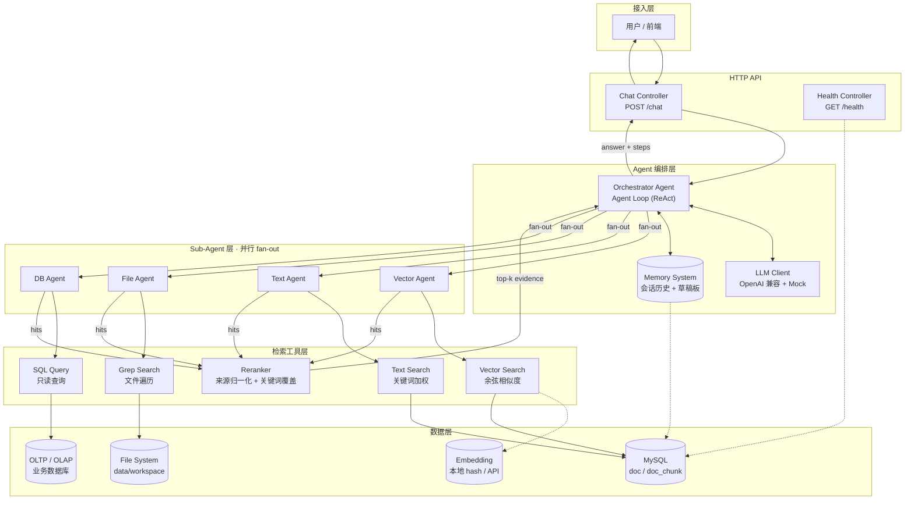
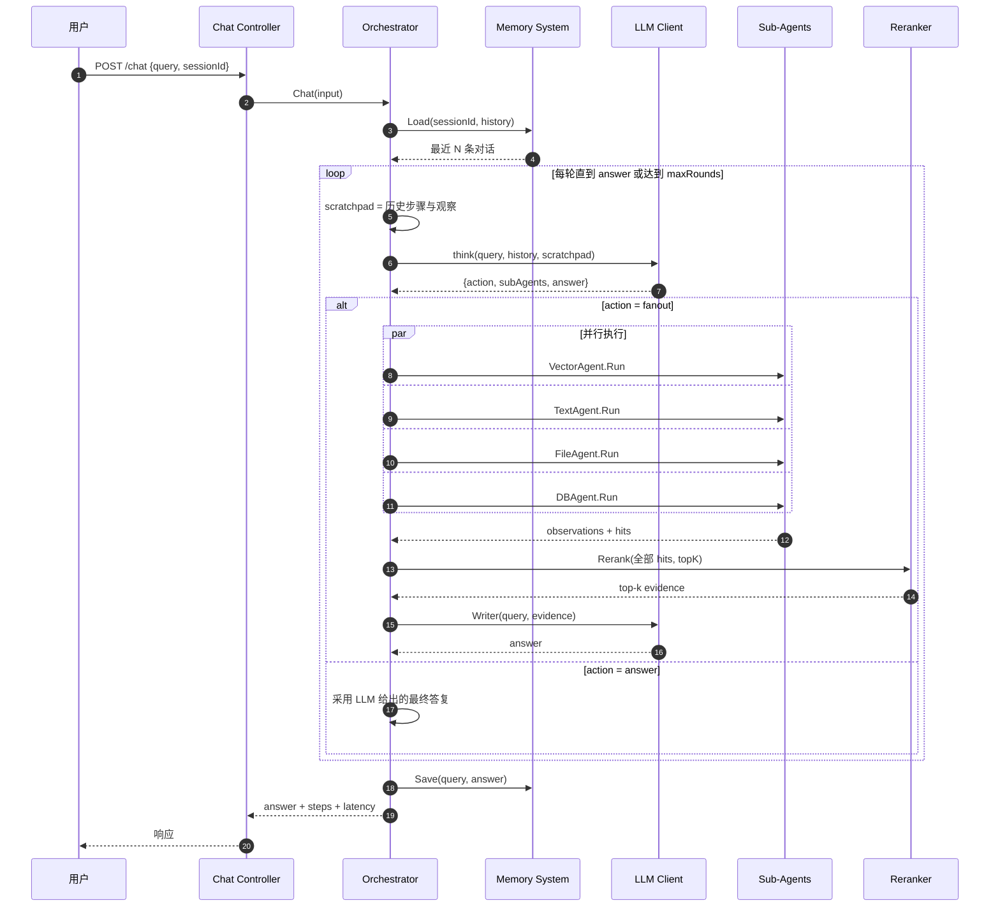

# ali-agent 架构图

> 对应阿里 2026「Agent 循环 + 多路检索」架构的本地实现版本。
> 图中实线为已实现链路，虚线为配置/依赖关系。

## 1. 总体架构

## 2. Agent Loop 时序

## 3. 目录与代码映射

| 架构图组件 | 代码位置 | 说明 |
|---|---|---|
| human → orchestrator | `api/v1/chat.go`、`internal/controller/chat` | HTTP 入口 |
| orchestrator agent | `internal/logic/orchestrator/orchestrator.go` | Agent Loop 主循环 |
| agent loop | `Chat()` 中的 `for round` | 思考 → fan-out → 观察 → 再思考 |
| memory system | `internal/logic/memory/memory.go` | 会话历史 + 请求内草稿板 |
| sub agent | `internal/logic/subagent/agents.go` | Vector / Text / File / DB 四个子 Agent |
| tool call | `internal/logic/retrieval/*.go` | 每个子 Agent 绑定的检索工具 |
| vector database | `retrieval/vector.go` | `doc_chunk.embedding` + 余弦相似度 |
| text database | `retrieval/text.go` | `doc_chunk` 关键词加权匹配 |
| file system / branch state | `retrieval/fs.go` | `retrieval.fs.root` 目录 grep |
| OLTP / OLAP | `retrieval/db.go` | 只读 SELECT 查询业务库 |
| reranker | `retrieval/rerank.go` | 来源归一化 + 关键词覆盖率 |
| LLM | `internal/utility/llm/llm.go` | OpenAI 兼容 + Mock |
| embedding | `internal/utility/embedding/embedding.go` | 本地 hashed n-gram / 远程 API |
| 存储 | `internal/bootstrap/bootstrap.go` | MySQL 建表与种子数据 |

## 4. 与阿里架构图的对应关系

| 阿里架构图 | ali-agent 实现 | 实现程度 |
|---|---|---|
| human → orchestrator agent | `POST /chat` | 真实 |
| agent loop 自循环 | `Chat()` 多轮循环 | 真实循环，Mock 路径固定 |
| read/write memory system | 会话表 + 草稿板 | 会话持久化，草稿板仅请求内 |
| fan-out 多个 sub agent | goroutine + WaitGroup | 真实并行 |
| sub agent → tool call | 每个子 Agent 调自己的工具 | 工具绑定固定，LLM 只生成查询参数 |
| reranker → top k | `retrieval/rerank.go` | 启发式重排，非 cross-encoder |
| vector database | MySQL 全表 + 内存余弦 | 无 ANN 索引 |
| text database | MySQL LIKE 查询 | 与向量库共用一张表 |
| file system / branch state | 配置目录 grep | 无 git 分支/版本概念 |
| CLI / SQL → OLTP / OLAP | 执行 LLM 生成的 SELECT | 白名单与限流需加强 |

## 5. 当前实现边界

- **真实落地**：HTTP 接入、Agent 多轮循环、四路并行 fan-out、四路检索、重排、Writer、会话记忆、步骤追踪
- **Mock 可跑**：LLM 与子 Agent 决策；答案由证据拼接生成
- **简化实现**：向量检索（全表扫描）、文本检索（LIKE）、重排（启发式）、branch state（普通目录）、NL2SQL（直接执行）
- **未实现**：跨轮证据累积、Critic 校验、文档入库接口、鉴权/多租户、流式输出、可观测指标
